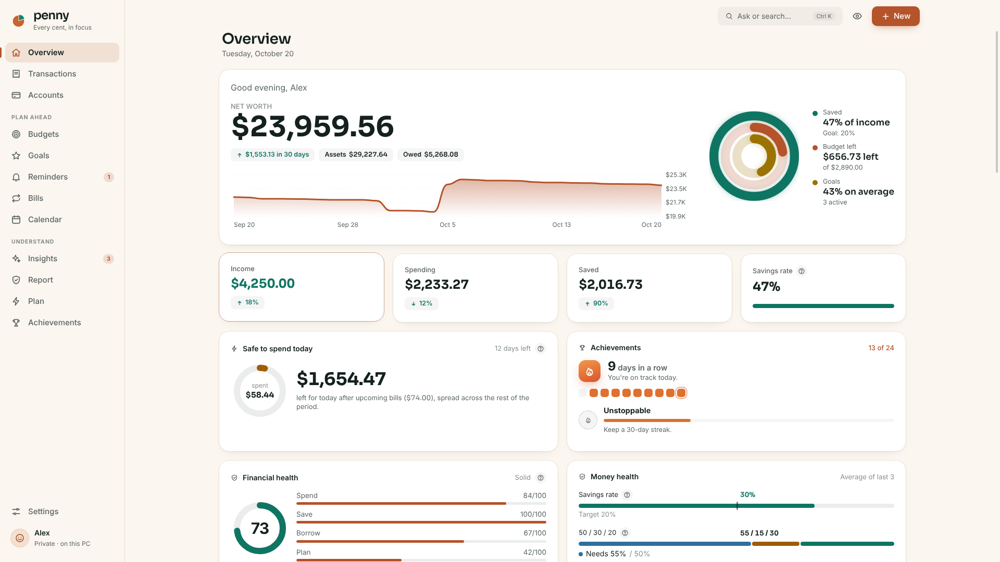

<h1 align="center">Penny</h1>

<b>Every cent, in focus.</b> A private budget app for Windows — encrypted, offline, in your language.

<a href="https://github.com/abdallhhelles/Penny/releases/latest">Download</a> · <a href="https://abdallhhelles.github.io/Penny/">Website</a> · <a href="CHANGELOG.md">What's new</a> · <a href="https://discord.gg/r5kNGC6p29">Discord</a>

---

## Get Penny
- **Microsoft Store:** [Penny – Budget & Money Tracker](https://apps.microsoft.com/detail/9NZJGZ0X9VDT) (updates through the Store)
- **Direct download:** the installer on the [Releases](https://github.com/abdallhhelles/Penny/releases) page. Penny then keeps itself up to date: it checks this page, verifies each update's signature, and asks you to restart.

Windows 10 or 11, x64. Free during the beta.

## Why Penny
- **Private by design.** Everything stays on your PC. No account, no cloud, no ads, no analytics, never asks for bank passwords.
- **Encrypted.** Your data, every backup and every receipt are encrypted with AES-256, locked to your Windows account; add a passcode for a second lock with a recovery key. See [SECURITY.md](docs/SECURITY.md).
- **Fast to use.** Type "coffee 4.50 yesterday" and Penny fills in the rest. Drop a bank statement on the window to import it.
- **Honest guidance.** A Financial Health Report scored with the [Penny Research model](docs/RESEARCH.md), with a short action plan and a one-click PDF.
- **For everyone.** English, Chinese (Simplified), Hindi, Spanish and Arabic, including natural-language entry; any currency, local number and date formats.

## Help and feedback
- Questions, ideas and news: [the Penny Discord](https://discord.gg/r5kNGC6p29)
- Bugs and requests: [Issues](https://github.com/abdallhhelles/Penny/issues)
- Security problems: see [SECURITY.md](docs/SECURITY.md#reporting-a-vulnerability)

## About this repository
This repository holds Penny's releases, release notes, website and public documents. Penny's source code is private.

## License
© 2026 Akrot Software. All rights reserved. See [installer/LICENSE.txt](installer/LICENSE.txt) for the end-user license and [installer/PRIVACY.txt](installer/PRIVACY.txt) for the privacy notice.
